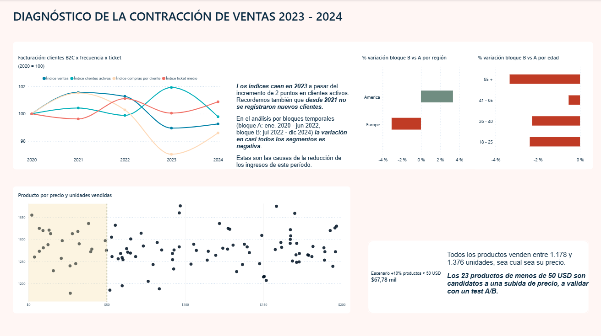
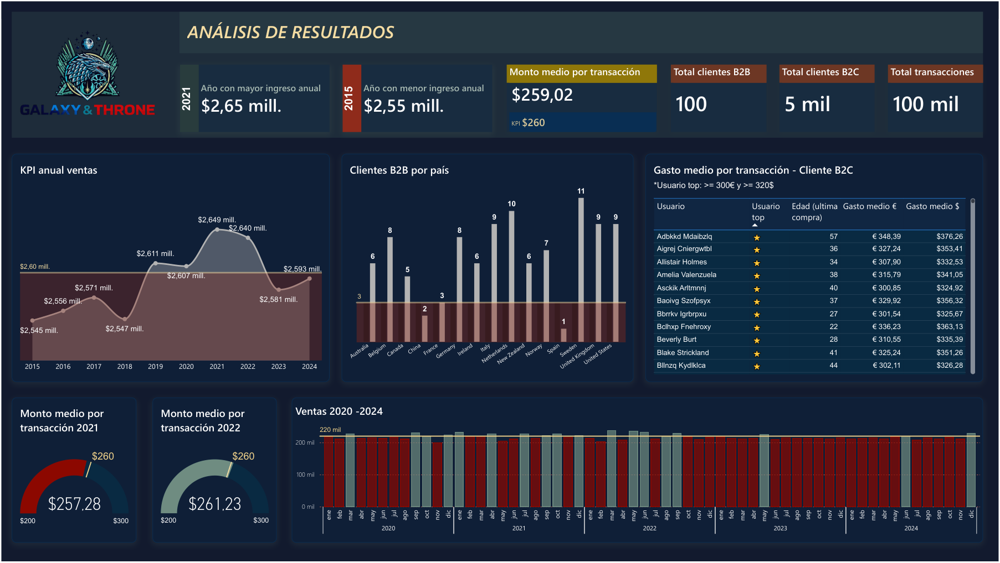
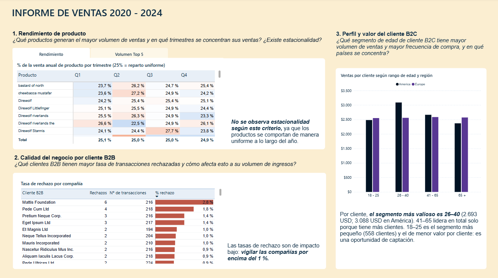
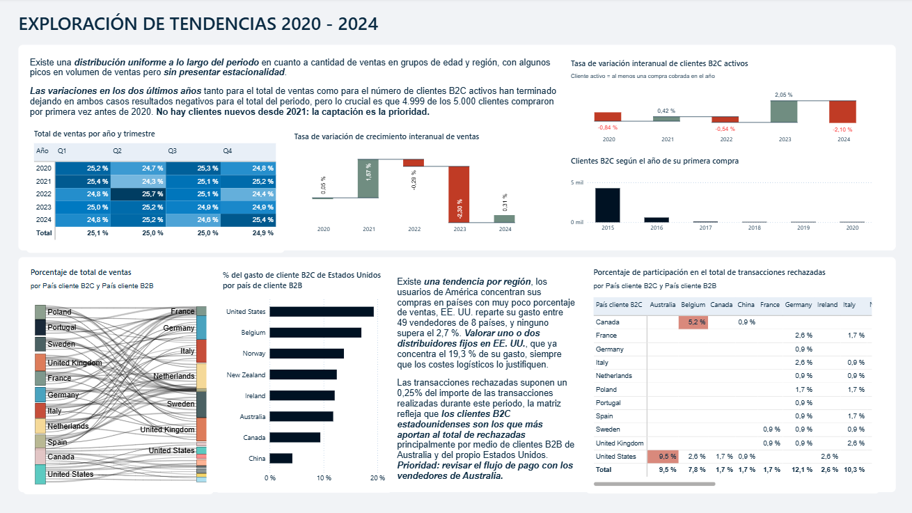
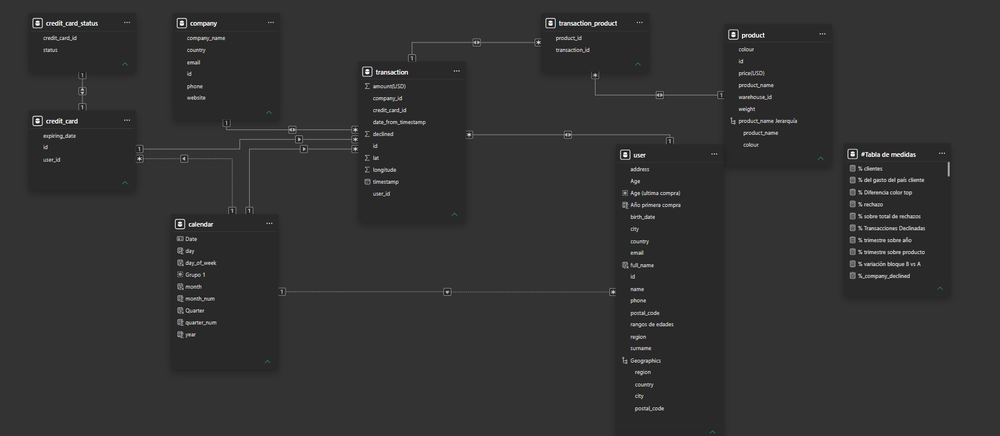

# Galaxy & Throne · Sales Analysis 2020–2024 (Power BI)

[Español](README.md) · **English**

**Why did sales fall in 2023–2024?** Because clients are buying less often and the client base is not renewing itself: no new clients have joined since 2021.



[View the full report (PDF)](galaxy_throne_analisis_ventas.pdf) · [Download the .pbix](galaxy_throne_analisis_ventas.pbix) · [Full analysis (Spanish)](docs/analisis_completo.md)

The report itself is in Spanish.

---

## The project

Galaxy & Throne is a fictional online retailer of fantasy and sci-fi merchandise. It sells to individual consumers (B2C) through 100 seller companies (B2B clients). The data comes from a MySQL training database from the IT Academy (Barcelona Activa) Data Analytics programme, connected to Power BI via ODBC. The name, logo and visual identity of the report are my own.

The report combines two deliverables: a first KPI dashboard against targets, and a 2020–2024 sales report with a diagnosis. This is the second version, which applies my tutor's feedback: normalise the data, cross criteria and end each analysis with a recommendation.

**Scope (2020–2024):** 50,433 transactions · USD 13.04 M in paid sales · 5,000 B2C clients · 100 B2B clients · 100 products.

## Key findings

| Finding | Recommendation |
|---|---|
| **The drop comes from purchase frequency, not from losing clients.** Comparing two equal 2.5-year blocks, sales fall 1.7% with the same number of clients (+0.1%) and the same average ticket (+0.2%): what falls is purchases per client (−2.1%). Europe is down 3.1% and America is up 3.4%. | Repeat-purchase actions in Europe: reminders and rewards for repeat purchases. |
| **The client base is closed.** 4,999 of the 5,000 clients made their first purchase before 2020. Year-to-year retention is high (85–87%), so sales depend on the same clients buying again. | Acquisition is the priority: a new-clients-per-quarter KPI and campaigns aimed at the highest-value segments. |
| **Per client, the most valuable segment is 26–40, not 41–65.** 41–65 leads total sales only because it has the most clients. 26–40 brings in USD 2,693 per client, and USD 3,088 in America (+21% vs Europe). | Prioritise 26–40 in America in acquisition campaigns. |

Other results (details in the [full analysis](docs/analisis_completo.md), in Spanish):

- **Demand does not react to price.** Every product sells between 1,178 and 1,376 units, whatever its price. A 10% increase on the 23 products under USD 50 would add about USD 68k over 5 years, to be validated with an A/B test.
- **No seasonality.** Each year's sales are spread almost evenly across quarters (24.3–25.7%).
- **Declined payments are rare (0.23%) and concentrated among US clients.** Their decline rate is 0.64%, against 0.15% for European clients. The financial impact is low: about USD 8k over 5 years.

## The report

| Page | Contents |
|---|---|
| KPIs | Annual and monthly sales against targets, average ticket, B2B clients by country, B2C clients with the highest average spend |
| Foco Alemania | Sales and average ticket of German companies in 2018–2019 |
| Segmentación B2C | Clients by country and age range, spend per transaction (box plot) |
| Informe 2020–2024 | Product performance and seasonality, decline rate by company, value per client by age and region |
| Tendencias 2020–2024 | Year-on-year change in sales and active clients, year of first purchase, flows from client country to seller country (Sankey), declines by country |
| Diagnóstico 2023–2024 | Revenue breakdown (clients × frequency × ticket), comparable time blocks, price vs units sold |

| | |
|---|---|
|  |  |
|  |  |

## How it is built



- **Model:** `transaction` is the fact table and `transaction_product` resolves the many-to-many relationship with `product`. The `calendar` table (`CALENDARAUTO()`) has one active relationship with the transaction date and two inactive ones (birth date and card expiry date).
- **Power Query:** client age and age ranges, date derived from the timestamp.
- **DAX:** 88 measures in a dedicated measures table, organised in folders: targets, paid and declined sales, active clients, churn, year-on-year change, indices and scenarios. [See all of them](docs/medidas_dax.md).
- **Visuals:** bookmarks and bookmark navigator, report-page tooltip, conditional formatting, Sankey diagram, waterfall and scatter charts.

Three measures from the second version:

```dax
// Real revenue per product: units × price
// (previously each product was credited with the full basket amount)
Ventas producto =
CALCULATE (
    SUMX ( 'transaction_product', RELATED ( 'product'[price(USD)] ) ),
    'transaction'[declined] = 0
)

// Normalisation: share of a product's yearly sales that falls in each quarter
% trimestre sobre producto =
DIVIDE (
    [Ventas producto],
    CALCULATE ( [Ventas producto], REMOVEFILTERS ( 'calendar'[Quarter], 'calendar'[quarter_num] ) )
)

// 2020-based index used to break down revenue
Índice compras por cliente =
DIVIDE ( [Compras por cliente], CALCULATE ( [Compras por cliente], 'calendar'[year] = 2020 ) ) * 100
```

## Limitations

- Client age is calculated in Power Query from the refresh date, not the date of each purchase, so the age ranges shift every time the report is refreshed.
- The dataset is fictional and very uniform: differences between segments are a few percentage points, so the recommendations should be validated with experiments.

## How to open it

- **Without installing anything:** the [PDF](galaxy_throne_analisis_ventas.pdf) contains the six report pages.
- **In Power BI Desktop (Windows):** open the `.pbix`. The data is imported, so the report works offline, but it cannot be refreshed because the source is a local MySQL database.

```
├── README.md
├── README.en.md
├── galaxy_throne_analisis_ventas.pbix
├── galaxy_throne_analisis_ventas.pdf
├── images/
└── docs/
    ├── analisis_completo.md
    └── medidas_dax.md
```

**Tools:** Power BI (DAX, Power Query) · MySQL

---

Tania Adrianzen Acero · [LinkedIn](https://www.linkedin.com/in/tania-adrianzen-acero)
