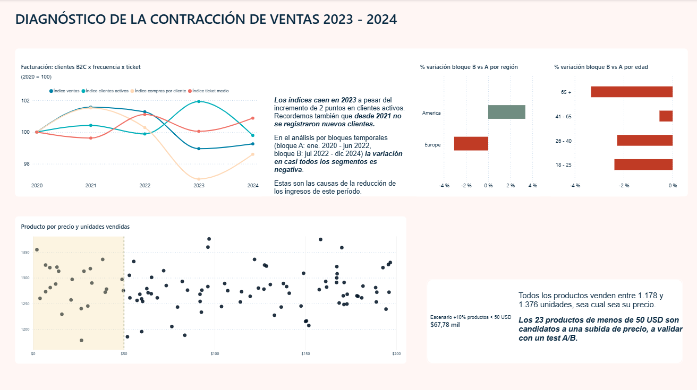
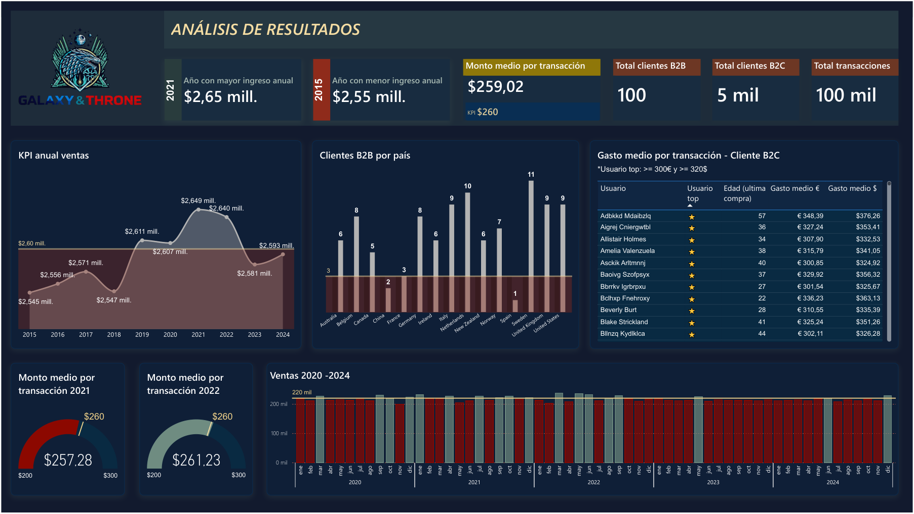
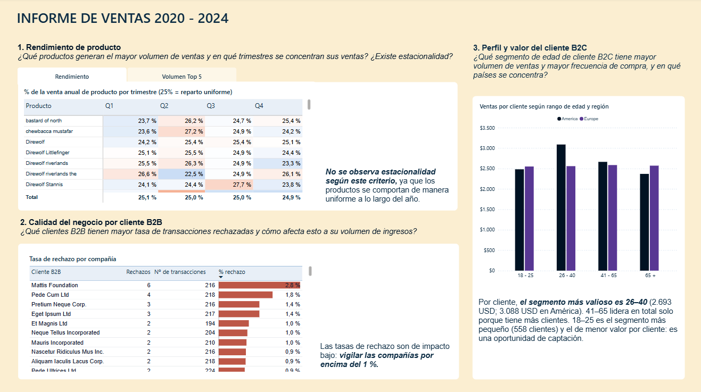
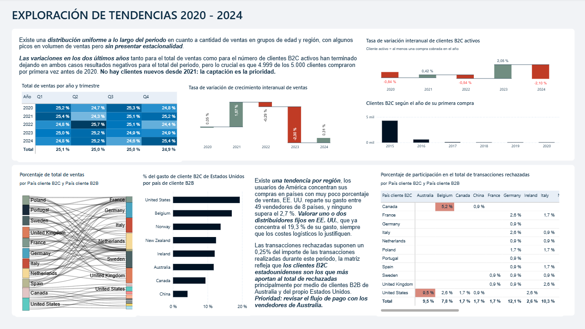
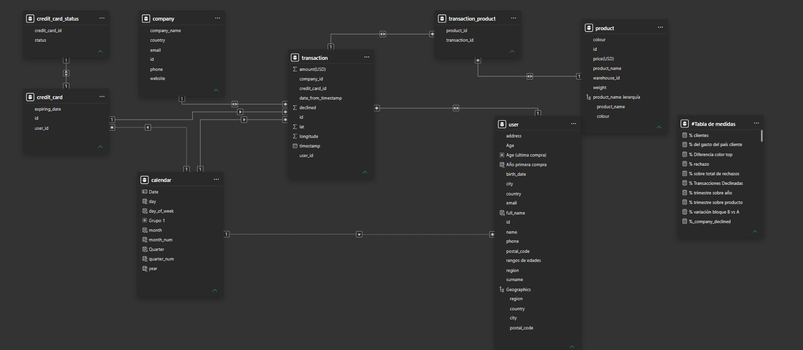

# Galaxy & Throne · Análisis de ventas 2020–2024 (Power BI)

**Español** · [English](README.en.md)

**¿Por qué caen las ventas en 2023–2024?** Porque los clientes compran con menos frecuencia y la base de clientes no se renueva: desde 2021 no entra ningún cliente nuevo.



[Ver el informe completo en PDF](galaxy_throne_analisis_ventas.pdf) · [Descargar el .pbix](galaxy_throne_analisis_ventas.pbix) · [Análisis completo](docs/analisis_completo.md)

---

## El proyecto

Galaxy & Throne es una tienda online ficticia de merchandising de fantasía y ciencia ficción. Vende a clientes particulares (B2C) a través de 100 empresas vendedoras (clientes B2B). Los datos proceden de una base de datos MySQL de formación del programa de Data Analytics de IT Academy (Barcelona Activa), conectada a Power BI por ODBC. El nombre, el logotipo y la identidad visual del informe son de creación propia.

El informe reúne dos entregas: un primer dashboard de KPIs frente a metas y un informe de ventas 2020–2024 con diagnóstico. Esta es la segunda versión, que incorpora las correcciones de mi tutora: normalizar los datos, cruzar criterios y cerrar cada análisis con una recomendación.

**Alcance (2020–2024):** 50.433 transacciones · 13,04 M USD en ventas cobradas · 5.000 clientes B2C · 100 clientes B2B · 100 productos.

## Hallazgos principales

| Hallazgo | Recomendación |
|---|---|
| **La caída es de frecuencia, no de clientes.** Comparando dos bloques iguales de 2,5 años, las ventas bajan un 1,7 % con los mismos clientes (+0,1 %) y el mismo ticket (+0,2 %): lo que cae son las compras por cliente (−2,1 %). Europa baja un 3,1 % y América sube un 3,4 %. | Acciones de recompra en Europa: recordatorios y recompensas por compra repetida. |
| **La base de clientes está cerrada.** 4.999 de los 5.000 clientes compraron por primera vez antes de 2020. La retención anual es alta (85–87 %), así que las ventas dependen de que los mismos clientes vuelvan a comprar. | La captación es la prioridad: un KPI de clientes nuevos por trimestre y campañas para los segmentos de más valor. |
| **El segmento más valioso por cliente es 26–40, no 41–65.** 41–65 lidera en ventas totales solo porque tiene más clientes. 26–40 aporta 2.693 USD por cliente, y 3.088 USD en América (+21 % frente a Europa). | Priorizar el segmento 26–40 en América en las campañas de captación. |

Otros resultados (detalle en el [análisis completo](docs/analisis_completo.md)):

- **La demanda no reacciona al precio.** Todos los productos venden entre 1.178 y 1.376 unidades sea cual sea su precio. Una subida del 10 % en los 23 productos de menos de 50 USD supondría unos 68.000 USD en 5 años, a validar con un test A/B.
- **No hay estacionalidad.** Las ventas de cada año se reparten casi por igual entre trimestres (24,3–25,7 %).
- **Los rechazos de pago son pocos (0,23 %) y se concentran en clientes de EE. UU.** Tienen una tasa del 0,64 %, frente al 0,15 % de los europeos. El impacto económico es bajo: unos 8.000 USD en 5 años.

## El informe

| Página | Contenido |
|---|---|
| KPIs | Ventas anuales y mensuales frente a metas, ticket medio, clientes B2B por país, clientes B2C con mayor gasto medio |
| Foco Alemania | Ventas y ticket medio de las compañías alemanas en 2018–2019 |
| Segmentación B2C | Clientes por país y rango de edad, distribución del gasto por transacción (diagrama de caja) |
| Informe 2020–2024 | Rendimiento de producto y estacionalidad, tasa de rechazo por compañía, valor por cliente según edad y región |
| Tendencias 2020–2024 | Variación interanual de ventas y de clientes activos, año de primera compra, flujos entre país de cliente y país de vendedor (Sankey), rechazos por país |
| Diagnóstico 2023–2024 | Descomposición de la facturación (clientes × frecuencia × ticket), bloques temporales comparables, precio frente a unidades vendidas |

| | |
|---|---|
|  |  |
|  |  |

## Cómo está construido



- **Modelo:** `transaction` es la tabla de hechos y `transaction_product` resuelve la relación muchos a muchos con `product`. La tabla `calendar` (`CALENDARAUTO()`) tiene una relación activa con la fecha de transacción y dos inactivas (fecha de nacimiento y caducidad de la tarjeta).
- **Power Query:** edad y rangos de edad del cliente, fecha derivada del timestamp.
- **DAX:** 88 medidas en una tabla de medidas propia, organizadas en carpetas: metas, ventas cobradas y rechazadas, clientes activos, abandono, variación interanual, índices y escenarios. [Ver todas](docs/medidas_dax.md).
- **Visualización:** marcadores y navegador de marcadores, tooltip de página, formato condicional, diagrama de Sankey, gráficos de cascada y de dispersión.

Tres medidas de la segunda versión:

```dax
// Facturación real por producto: unidades × precio
// (antes se atribuía a cada producto el importe completo de la cesta)
Ventas producto =
CALCULATE (
    SUMX ( 'transaction_product', RELATED ( 'product'[price(USD)] ) ),
    'transaction'[declined] = 0
)

// Normalización: qué parte de la venta anual de un producto cae en cada trimestre
% trimestre sobre producto =
DIVIDE (
    [Ventas producto],
    CALCULATE ( [Ventas producto], REMOVEFILTERS ( 'calendar'[Quarter], 'calendar'[quarter_num] ) )
)

// Índice base 2020 para descomponer la facturación
Índice compras por cliente =
DIVIDE ( [Compras por cliente], CALCULATE ( [Compras por cliente], 'calendar'[year] = 2020 ) ) * 100
```

## Limitaciones

- La edad del cliente se calcula en Power Query respecto a la fecha de actualización, no a la de cada compra, así que los rangos de edad cambian con cada actualización.
- El dataset es ficticio y muy uniforme: las diferencias entre segmentos son de pocos puntos porcentuales, por lo que las recomendaciones deberían validarse con experimentos.

## Cómo abrirlo

- **Sin instalar nada:** el [PDF](galaxy_throne_analisis_ventas.pdf) contiene las seis páginas del informe.
- **En Power BI Desktop (Windows):** abre el `.pbix`. Los datos están importados, así que el informe funciona sin conexión, pero no se puede actualizar porque la fuente es una base de datos MySQL local.

```
├── README.md
├── README.en.md
├── galaxy_throne_analisis_ventas.pbix
├── galaxy_throne_analisis_ventas.pdf
├── images/
└── docs/
    ├── analisis_completo.md
    └── medidas_dax.md
```

**Herramientas:** Power BI (DAX, Power Query) · MySQL

---

Tania Adrianzen Acero · [LinkedIn](https://www.linkedin.com/in/tania-adrianzen-acero)
