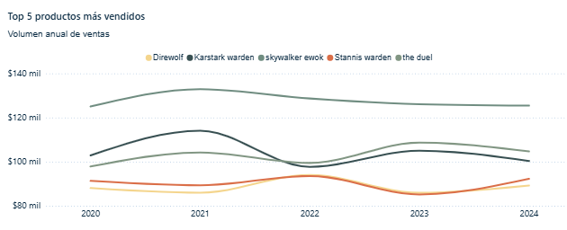
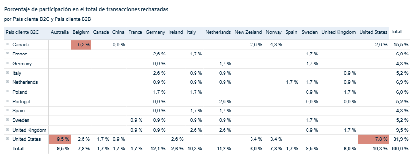
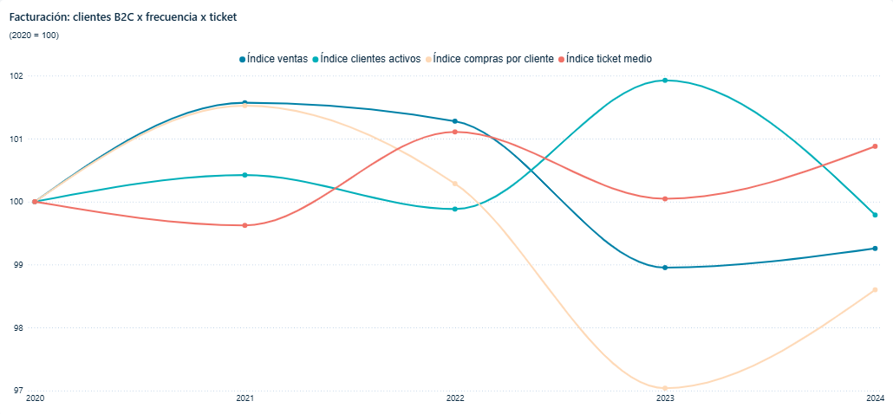

# Análisis completo · Galaxy & Throne 2020–2024

[Volver al README](../README.md)

Todas las cifras se refieren a 2020–2024 y a transacciones cobradas (no rechazadas), salvo cuando se habla de rechazos. Un **cliente activo** es el que tiene al menos una compra cobrada en el periodo.

## Índice

1. [Qué cambia respecto a la primera versión](#1-qué-cambia-respecto-a-la-primera-versión)
2. [Producto](#2-producto)
3. [Clientes B2B: rechazos de pago](#3-clientes-b2b-rechazos-de-pago)
4. [Clientes B2C: valor por segmento](#4-clientes-b2c-valor-por-segmento)
5. [Tendencias](#5-tendencias)
6. [Diagnóstico de la contracción de 2023–2024](#6-diagnóstico-de-la-contracción-de-20232024)
7. [Resumen de recomendaciones](#7-resumen-de-recomendaciones)

---

## 1. Qué cambia respecto a la primera versión

La revisión de mi tutora pedía normalizar, cruzar criterios, recomendar e ir al grano. En la práctica:

| Primera versión | Segunda versión |
|---|---|
| Ventas totales por segmento | Ventas **por cliente**, cruzadas por región |
| Ventas por trimestre en valor absoluto | **% de la venta anual** de cada producto en cada trimestre (25 % = reparto uniforme) |
| Cada producto sumaba el importe completo de la cesta | Facturación por producto = **unidades × precio** |
| 2020–2022 (3 años) frente a 2023–2024 (2 años) | Dos **bloques iguales** de 2,5 años |
| Conclusiones descriptivas | Cada análisis termina con una **recomendación** o un escenario cuantificado |

## 2. Producto

**¿Qué productos venden más y hay estacionalidad?**

Los 100 productos se agrupan en 70 líneas (varios productos comparten nombre).

**Estacionalidad.** En las 10 líneas que más facturan, cada trimestre recoge entre el 23,4 % y el 27,9 % de la venta anual. En el conjunto de las 70 líneas hay picos aislados (hasta el 32 %), pero caen en trimestres distintos según la línea y no forman un patrón. Las ventas totales de cada año también se reparten casi por igual (24,3–25,7 % por trimestre).

**Top 5 por facturación** (unidades × precio): *skywalker ewok*, *Karstark warden*, *the duel*, *Stannis warden* y *Direwolf*.

La mayoría de años se mantienen a ±7 % de 2020. *Karstark warden* tuvo un pico del +11 % en 2021 y bajó después. *the duel* es la única línea que termina claramente por encima de 2020 (+11 % en 2023 y +7 % en 2024).

> **Nota metodológica.** En la primera versión, las ventas de cada producto sumaban el importe completo de la transacción, de modo que a cada producto se le atribuía también lo que se había comprado junto a él. El importe de cada transacción coincide con la suma de los precios de sus productos (comprobado en las 100.000 transacciones), así que unidades × precio da la facturación real por producto. Con esta corrección, *Winterfell* y *dooku solo* salen del top 5 y entran *Stannis warden* y *Direwolf*.

**Recomendación:** planificar stock y campañas de forma uniforme durante el año. Los datos no justifican promociones estacionales.

## 3. Clientes B2B: rechazos de pago

**¿Qué compañías tienen más rechazos y cuánto les afecta?**

Hubo 116 transacciones rechazadas (0,23 % del total, 32.000 USD, un 0,25 % del importe). 32 de las 100 compañías no tienen ningún rechazo.

Cinco compañías superan el 1 %. La más alta, *Mattis Foundation*, llega al 2,78 %, doce veces la media, pero son solo 6 rechazos en 216 transacciones.

**Recomendación:** prioridad baja. Vigilar las cinco compañías por encima del 1 % en lugar de actuar sobre ellas.

## 4. Clientes B2C: valor por segmento

**¿Qué segmento de edad compra más y con qué frecuencia?**

| Rango de edad | Clientes | Ventas totales | Ventas por cliente | Compras por cliente |
|---|---:|---:|---:|---:|
| 18–25 | 558 | 1,42 M USD | 2.539 USD | 9,7 |
| 26–40 | 1.429 | 3,85 M USD | 2.693 USD | 10,4 |
| 41–65 | 2.126 | 5,53 M USD | 2.600 USD | 10,0 |
| 65+ | 886 | 2,25 M USD | 2.535 USD | 9,8 |

Las cifras suman las dos regiones.

41–65 lidera en ventas totales solo porque tiene más clientes. Por cliente, el segmento más valioso es 26–40, sobre todo en América: 3.088 USD y 11,8 compras por cliente, frente a 2.559 USD y 10,0 compras en Europa (+21 %). 18–25 es el segmento más pequeño (11 % de los clientes) y, junto con 65+, el de menor valor por cliente.

**Recomendación:** priorizar 26–40 en América para la captación. Tratar 18–25 como oportunidad de crecimiento, no como núcleo del negocio.

## 5. Tendencias

### Clientes activos y nuevos

Cada año hay entre 4.245 y 4.336 clientes activos, y la retención de un año al siguiente es del 85–87 %. Pero 4.999 de los 5.000 clientes compraron por primera vez antes de 2020 (el último cliente nuevo llegó en 2020), y la captación prácticamente se detuvo a partir de 2017.

Las ventas se sostienen con los mismos clientes que vuelven a comprar, así que cualquier caída de frecuencia se nota directamente en la facturación.

### Clientes de EE. UU.

Los clientes de EE. UU. generan el 11,5 % de la facturación (1,50 M USD). Su gasto se reparte entre 49 vendedores de 8 países y ningún vendedor supera el 2,7 %. La mayor parte va a vendedores estadounidenses (19,3 %).

**Escenario:** canalizar esta demanda a través de uno o dos distribuidores fijos en EE. UU. podría simplificar la operación y los pagos (EE. UU. es el país con más rechazos). El dataset no incluye costes logísticos, así que habría que comprobarlo antes de decidir.

### Dónde se concentran los rechazos

Los clientes de EE. UU. tienen una tasa de rechazo del 0,64 %, frente al 0,15 % de los clientes europeos, y suman el 32 % de todos los rechazos. Las dos celdas más altas de la matriz son clientes de EE. UU. que compran a vendedores de Australia (9,5 % de los rechazos, con una tasa del 1,64 %) y de EE. UU. (7,8 %).

**Escenario:** si los clientes de EE. UU. tuvieran la tasa europea, habría unos 28 rechazos menos, unos 8.000 USD en 5 años. La recomendación es revisar primero el flujo de pago entre clientes de EE. UU. y vendedores de Australia, donde la tasa es más alta.

## 6. Diagnóstico de la contracción de 2023–2024

### Descomposición de la facturación

Facturación = clientes activos × compras por cliente × ticket medio.

En 2023 la facturación cayó un 2,3 %. Los clientes activos subieron un 2,1 % y el ticket medio apenas varió (−1,1 %), pero las compras por cliente cayeron un 3,2 %.

### Bloques comparables

El informe original comparaba 2020–2022 (3 años) con 2023–2024 (2 años). Aquí el periodo se divide en dos bloques iguales: A (enero 2020 – junio 2022) y B (julio 2022 – diciembre 2024).

| Variación B frente a A | |
|---|---:|
| Ventas | −1,7 % |
| Clientes activos | +0,1 % |
| Ticket medio | +0,2 % |
| Compras por cliente | −2,1 % |
| Europa | −3,1 % |
| América | +3,4 % |
| 65+ | −3,3 % |
| 18–25 | −2,4 % |
| 26–40 | −2,3 % |
| 41–65 | −0,5 % |

Con bloques iguales, el segmento 41–65 apenas varía, lo que corrige la conclusión de la primera versión.

### Precio y unidades

Todos los productos venden entre 1.178 y 1.376 unidades, sea cual sea su precio (correlación de 0,01). Los 23 productos de menos de 50 USD aportan solo el 5,2 % de la facturación, lo que los convierte en el lugar más seguro para probar una subida de precio.

**Escenario:** una subida del 10 % en esos 23 productos, con el mismo volumen, supondría unos 68.000 USD más en 5 años.

### Venta cruzada

Los pares de líneas que más se compran juntos (más de 200 veces en 5 años) no aparecen juntos más de lo esperable por azar (lift máximo de 1,11). Hay algunos pares de productos con más asociación, pero con muy pocas compras conjuntas (70–90 en 5 años) para diseñar packs a partir de ellos.

**Conclusión:** la contracción viene de que los clientes repiten menos compras, sobre todo en Europa, dentro de una base de clientes que no se renueva.

## 7. Resumen de recomendaciones

| Prioridad | Acción | Base |
|---|---|---|
| Alta | Crear un KPI de clientes nuevos por trimestre y lanzar campañas de captación | Ningún cliente nuevo desde 2021 |
| Alta | Acciones de recompra en Europa | Caída de frecuencia (−2,1 %) concentrada en Europa (−3,1 %) |
| Media | Priorizar el segmento 26–40 en América | Mayor valor por cliente (3.088 USD) |
| Media | Test A/B de +10 % en los productos de menos de 50 USD | Demanda insensible al precio; unos 68.000 USD en 5 años |
| Baja | Revisar el flujo de pago EE. UU. → Australia y vigilar las compañías con más del 1 % de rechazos | Unos 8.000 USD en 5 años |
| Baja | Probar packs solo como experimento | Sin asociaciones claras entre productos |
